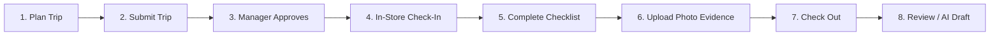

# FieldTrack — Pilot Onboarding Guide & Runbook

Welcome to the **FieldTrack Pilot**! This guide walks managers, field supervisors, and field representatives through setup, system configuration, and day-to-day retail field operations.

---

## 1. System Requirements & Setup

| Device Type                     | Recommended Browser / OS                              | Purpose                                                                        |
| :------------------------------ | :---------------------------------------------------- | :----------------------------------------------------------------------------- |
| **Mobile (Field Reps)**         | Apple Safari (iOS 16+) or Google Chrome (Android 12+) | In-store visit check-in, checklists, photo evidence, and checkout.             |
| **Desktop / Laptop (Managers)** | Google Chrome, Edge, or Firefox (latest versions)     | Trip planning, team administration, approvals, dashboard metrics, CSV exports. |

### Mobile Home Screen Installation (PWA)

For fast, app-like access in retail stores:

- **iOS Safari:** Navigate to your organization's FieldTrack staging URL, tap the **Share** button, and select **Add to Home Screen**.
- **Android Chrome:** Tap the three dots (menu) in the top-right corner and select **Install app** or **Add to Home screen**.

---

## 2. Manager & Administrator Onboarding

### Step 1: Register Account & Verify Email

1. Navigate to `/signup`.
2. Enter your work email and a secure password (minimum 8 characters).
3. Check your email inbox for the confirmation link and click to activate your account.

### Step 2: Create Your Organization Workspace

1. After signing in, you will be directed to `/onboarding`.
2. Enter your **Organization Name** (e.g. _Acme Merchandising Midwest_).
3. The system generates a unique workspace slug (e.g. `acme-merchandising-midwest`).
4. Click **Create Organization**. You are automatically granted the `admin` role for this organization.

### Step 3: Populate Store Directory

1. Navigate to **Stores** (`/stores`) in the navigation bar.
2. Click **Add Store** and complete the store profile:
   - **Store Name:** (e.g. _Kroger Store #412_)
   - **Region:** (e.g. _Midwest / Chicago North_)
   - **Address, City, State, Postal Code:** Accurate physical address.
   - **Coordinates (Optional):** Latitude & Longitude if geofence reference is desired.
3. Click **Save Store**. Repeat for all physical store locations in your territory.

### Step 4: Invite Team Members

1. Navigate to **Team** (`/team`).
2. Click **Invite Member**:
   - Enter their work email address.
   - Select their role:
     - `field_employee`: Can plan trips, check in, complete checklists, upload photos, and draft reports.
     - `manager`: Can manage stores, approve/reject trips, view organization-wide dashboards, and export CSV reports.
3. Click **Send Invitation**. The team member receives an invitation link.

---

## 3. Field Representative Onboarding

### Step 1: Accept Invitation

1. Open the invitation email and click **Join Organization**.
2. If new to FieldTrack, choose a password to complete registration.
3. You will be automatically connected to your organization with the `field_employee` role.

### Step 2: Location Permissions Primer

FieldTrack uses a **Privacy-First Geolocation Architecture**:

- FieldTrack **never** tracks your background location.
- The app requests your GPS location **only at the exact moment you tap Check In or Check Out**.
- When prompted by your mobile browser (_"FieldTrack would like to use your current location"_), tap **Allow while using app** or **Allow Once**.
- If permission is denied or GPS is unavailable, you can still proceed with your visit (marked as `permission_denied` or `unavailable` for managerial review).

---

## 4. Daily Field Operations Runbook

### Step 1: Plan a Field Trip

1. Navigate to **Trips** (`/trips`) and click **Plan New Trip** (`/trips/new`).
2. Fill in the trip details:
   - **Trip Title:** (e.g. _Q4 Beverage Endcap & Planogram Audit_)
   - **Purpose:** (e.g. _Verify holiday promotional displays and cooler stock_)
   - **Date Range:** Select planned start and end calendar dates.
3. Add destination stops:
   - Select destination stores from your organization's directory.
   - Arrange stops in your planned execution order.
4. Click **Save as Draft**. You can edit stops and dates at any time while in `draft` status.

### Step 2: Submit Trip for Review

1. Open your draft trip in `/trips/[tripId]`.
2. Review your stops and notes.
3. Click **Submit Trip for Approval**. The trip transitions to `submitted`.

### Step 3: Manager Approval Workflow

1. Field managers navigate to **Approvals** (`/approvals`).
2. Select any submitted trip to review its planned route and stores.
3. Choose an action:
   - **Approve:** Authorizes field execution. The trip transitions to `approved`.
   - **Request Changes:** Sends the trip back to the rep with specific review notes.
   - **Reject:** Declines the trip with an explanatory reason.

> [!NOTE]
> **Self-Approval Ban:** FieldTrack strictly forbids users from approving their own trips, even if they hold the `manager` or `admin` role. Trips must be approved by an independent manager.

### Step 4: In-Store Check-In

1. Upon arriving at the physical store, open the approved trip and click the scheduled stop.
2. Click **Start Visit / Check In**.
3. Accept the browser location prompt.
4. Your visit is now `in_progress`. The checklist is automatically initialized.

### Step 5: Complete Audit Checklist

1. Answer all required checklist questions:
   - **Planogram Alignment:** Verify shelf placement and promotional tags.
   - **Cooler Restock:** Check product availability.
   - **Flagged Issues:** If an item is out of compliance, toggle **Flag for Follow-up** and add notes.
2. Click **Save Checklist**.

### Step 6: Attach Photographic Evidence

1. Scroll to the **Photo Evidence** section.
2. Tap **Take Photo** or choose an image from your device library.
   - Allowed formats: `image/jpeg`, `image/png`, `image/webp`.
   - Maximum file size: **10 MB**.
3. Enter a clear caption (e.g. _Front promotional endcap facing aisle 3_).
4. Tap **Upload Evidence**. The photo is uploaded to your organization's private storage vault.

### Step 7: Check Out

1. In the **Visit Summary & Checkout** panel, enter visit notes summarizing actions taken.
2. Tap **Complete Visit & Check Out**.

> [!IMPORTANT]
> **Checklist Guard:** The system will block checkout if any required checklist item is unanswered.

3. The visit status updates to `submitted` and the stop updates to `visited`.
4. When all scheduled stops on a trip are checked out, the trip automatically completes.

### Step 8: Visit Report Drafting (Manual vs. AI-Assisted)

1. On the visit page, view the **Visit Report** section.
2. **AI-Assisted Draft (Optional):**
   - If enabled by your organization, click **Generate AI Report Draft**.
   - The server validates your visit notes, completed checklist items, and photo captions.
   - The AI generates a structured draft report with clear provenance attribution.
   - An authorized manager or employee reviews, edits, and clicks **Approve Draft as Final**.
   - All AI drafts remain stamped with `requiresHumanReview = true` until actively approved.
3. **Manual Reporting:**
   - If AI drafting is disabled or quota is reached, reps and managers can format and edit visit notes manually without restriction.

### Step 9: Manager Dashboard & CSV Reporting

1. Managers navigate to **Dashboard** (`/`).
2. View real-time operational metrics:
   - Trips by Status breakdown (Draft, Submitted, Approved, In Progress, Completed).
   - Pending approvals and urgent exceptions.
   - Planned vs. Actual stop execution cards with rep attribution.
3. To export operational data, click **Export Operational CSV**.
   - Generates an RFC 4180 compliant spreadsheet with formula-injection protection.

---

## 5. Troubleshooting & Frequently Asked Questions

### What happens if I lose internet connectivity inside a store?

FieldTrack features local caching. Your checklist selections and draft visit notes are preserved locally in your browser. Once you reconnect to network or store Wi-Fi, tap save/submit to sync.

### What if I accidentally denied location permissions?

1. **iOS Safari:** Tap the `aA` icon in the address bar -> **Website Settings** -> **Location** -> Select **Ask** or **Allow**.
2. **Android Chrome:** Tap the lock/tune icon next to the URL -> **Permissions** -> **Location** -> Select **Allowed**.
3. You can still check in even if location is unavailable; the system records `permission_denied` so you are never locked out of your visit.

### Why is photo upload failing?

1. Ensure your image file is under 10MB.
2. Check that the file format is JPEG, PNG, or WebP (HEIC photos from newer iPhones should be converted to JPEG automatically by Safari).
3. If uploads are temporarily disabled by the administrator, a banner will indicate `UPLOADS_ENABLED=false`.

### What does "AI Quota Exceeded" mean?

Each organization has a configured daily quota for AI report drafts (`ai_daily_draft_quota`, resets at 00:00 UTC). If exhausted, manual report drafting remains 100% available.
