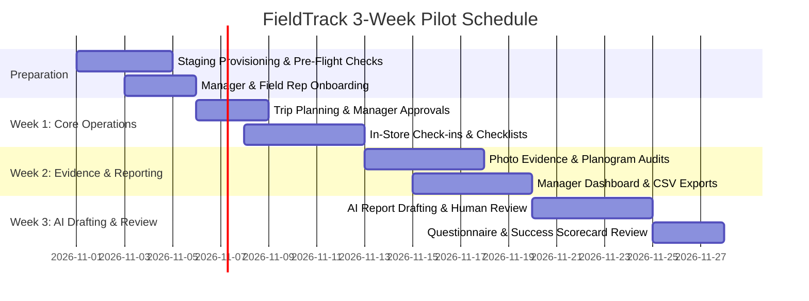

# FieldTrack — Pilot Execution Plan

**Version:** 1.0.0  
**Target Window:** 3-Week Structured Field Trial  
**Audience:** Retail Merchandising Agencies, Field Operations Directors, Field Representatives, and Platform Administrators.

---

## 1. Pilot Purpose & Strategic Objectives

The FieldTrack Pilot is a controlled, 3-week operational evaluation designed to validate FieldTrack in real-world retail store merchandising, planogram compliance, and field audit workflows.

### Core Objectives

1. **Validate Core Workflow Usability:** Confirm that field representatives can plan trips, check in, complete required checklist audits, attach photos, and check out in real stores with minimal friction.
2. **Measure Operational Time Savings:** Quantify reduction in field reporting overhead, from post-visit administrative writeups to automated visit documentation and AI-assisted drafting.
3. **Verify Manager Operational Oversight:** Ensure field operations managers have real-time visibility into stop status, visit completion, planogram exceptions, and audit logs.
4. **Stress-Test Security & Reliability:** Validate multi-tenant isolation, location consent handling, photo evidence upload integrity, and resilient offline drafting under spotty retail store network conditions.
5. **Establish Commercial Viability:** Evaluate user willingness to adopt FieldTrack permanently over legacy spreadsheets and manual paper logs.

---

## 2. Pilot Cohort Structure

| Cohort Parameter                 | Target Profile                                                                                                                               |
| :------------------------------- | :------------------------------------------------------------------------------------------------------------------------------------------- |
| **Participant Organizations**    | 2–3 mid-sized retail merchandising or field service agencies (e.g. consumer packaged goods, consumer electronics, or beverage distributors). |
| **Field Representatives**        | 10–25 active field reps executing scheduled store visits (minimum 3–5 visits per representative per week).                                   |
| **Field Managers / Supervisors** | 2–4 field managers responsible for trip approval, exception tracking, and weekly audit reviews.                                              |
| **Retail Store Scope**           | 50–150 physical retail locations (supermarkets, convenience stores, big-box retailers).                                                      |
| **Device Environment**           | Representative-owned or company-issued mobile devices (iOS Safari / Android Chrome PWA) and desktop browsers for managers.                   |

---

## 3. Timeline & Execution Phases

### Phase 0: Pre-Flight Onboarding (Days -4 to 0)

- Apply database migrations and verify remote Supabase staging environment.
- Provision organization workspaces and seed initial store directory master data.
- Distribute [`PILOT_ONBOARDING.md`](file:///Users/rahbarraza/Downloads/SAAS%20startup/PILOT_ONBOARDING.md) to managers and field representatives.
- Conduct a 30-minute virtual orientation session with field supervisors.

### Phase 1: Core Field Operations (Week 1)

- **Focus:** Field trip drafting, sequencing stops, submitting trips, manager approval workflows, and store visit check-in.
- **Key Milestones:**
  - 100% of participating representatives submit at least one multi-stop field trip.
  - Managers review and approve trips via the Approvals Inbox.
  - Representatives check in at physical store locations using point-in-time device location consent.
  - End-of-week sync to resolve initial device or usability questions.

### Phase 2: Evidence Capture & Manager Oversight (Week 2)

- **Focus:** Required checklist audit items, photo evidence attachment, checkout completion, and operational reporting.
- **Key Milestones:**
  - Representatives upload photographic evidence of store endcaps and displays.
  - Premature checkout prevention verified (all required items must be answered).
  - Complete checkouts auto-transition trips to `completed`.
  - Managers monitor live stop status on the Dashboard and generate weekly CSV audit exports.

### Phase 3: AI Report Drafting & Final Evaluation (Week 3)

- **Focus:** AI visit report drafting, human review/approval, feedback collection, and scorecard evaluation.
- **Key Milestones:**
  - Representatives and managers generate AI report drafts for completed visits.
  - Managers edit and approve drafts, verifying `requiresHumanReview` enforcement.
  - Administer [`PILOT_FEEDBACK_QUESTIONNAIRE.md`](file:///Users/rahbarraza/Downloads/SAAS%20startup/PILOT_FEEDBACK_QUESTIONNAIRE.md) to all participants.
  - Compute final metrics against [`PILOT_SUCCESS_SCORECARD.md`](file:///Users/rahbarraza/Downloads/SAAS%20startup/PILOT_SUCCESS_SCORECARD.md).

---

## 4. Operational Guardrails & Support Protocol

### Incident Response SLAs

| Severity          | Description                                                                            | Target Response | Target Resolution |
| :---------------- | :------------------------------------------------------------------------------------- | :-------------: | :---------------: |
| **P1 — Blocker**  | In-store check-in, checkout, or auth failure blocking a field rep during a live visit. |    < 15 mins    |     < 1 hour      |
| **P2 — Major**    | Photo evidence upload failure or trip approval workflow blocker.                       |    < 30 mins    |     < 4 hours     |
| **P3 — Moderate** | Dashboard metric discrepancy or CSV export formatting issue.                           |    < 2 hours    |    < 24 hours     |
| **P4 — Minor**    | Minor UI styling anomaly or non-blocking feedback.                                     |    < 4 hours    |  Next deployment  |

### Support Channels

- **Dedicated Slack / Teams Channel:** `#fieldtrack-pilot-support` for live rep and manager assistance.
- **Emergency Support Hotline:** SMS / Voice escalation for P1 in-store blockers.
- **Daily Operational Log:** SRE monitoring of application error rates, Supabase Storage throughput, and rate limit occurrences.

### Safety & Resiliency Guardrails

- **Standalone Manual Reporting:** If OpenAI API connectivity fails or daily quota is exhausted, field reps can complete visit notes manually without disruption.
- **Location Privacy Respect:** Location is captured only once upon check-in and checkout with explicit user permission; continuous background tracking is never enabled.
- **Offline Resiliency:** Checklist answers and visit notes are cached locally in browser IndexedDB/LocalStorage, protecting reps against store Wi-Fi dead-zones.

---

## 5. Roles & Responsibilities

| Role                          | Responsibilities                                                                                                 |
| :---------------------------- | :--------------------------------------------------------------------------------------------------------------- |
| **Pilot Sponsor (Executive)** | Approves participation, reviews final scorecard, and decides commercial adoption.                                |
| **Field Operations Manager**  | Manages store master list, approves field trips, reviews visit submissions, and evaluates dashboard/CSV exports. |
| **Field Representative**      | Plans trips, executes store visits, answers checklists, attaches photo evidence, and provides weekly feedback.   |
| **FieldTrack Pilot Lead**     | Manages onboarding, monitors system uptime, resolves technical incidents, and tabulates survey results.          |
