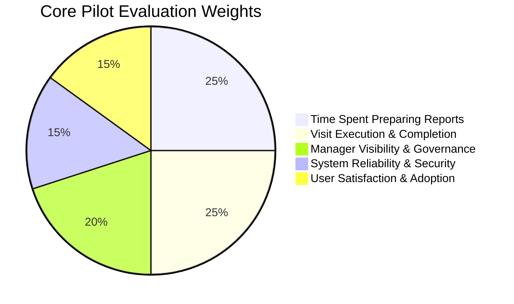
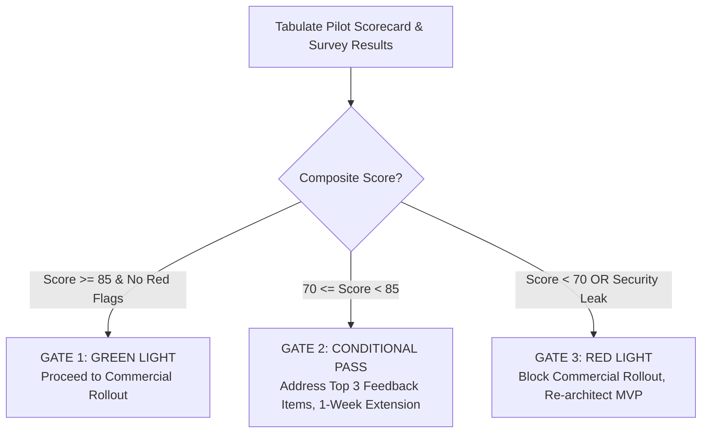

# FieldTrack — Pilot Success Scorecard & Evaluation Rubric

**Purpose:** This scorecard defines the quantitative benchmarks, acceptance thresholds, evaluation formulas, and commercial decision criteria used by executive sponsors and product leadership to determine the success of the FieldTrack pilot.

---

## 1. Core Success Dimensions & Key Performance Indicators

---

## 2. Quantitative Metric Scorecard

| Dimension                                    | KPI / Metric                                  |          Pre-Pilot Baseline (Legacy Workflow)           |                       Pilot Target                       |               Minimum Acceptable Threshold               | Measurement Method & Source                                                                       |
| :------------------------------------------- | :-------------------------------------------- | :-----------------------------------------------------: | :------------------------------------------------------: | :------------------------------------------------------: | :------------------------------------------------------------------------------------------------ |
| **1. Time Spent Preparing Reports (25%)**    | **Average Report Preparation Time per Visit** | 15 – 20 mins per visit (manual notes & photo collation) | **≤ 5 mins** per visit (with AI drafting + human review) |           ≤ 8 mins per visit (≥ 50% reduction)           | Timestamp diff: `checked_out_at` to draft review approval; confirmed via Questionnaire Section 3. |
|                                              | **Report Review & Approval Latency**          |                24 – 48 hours post-visit                 |                 **< 4 hours** post-visit                 |                  < 12 hours post-visit                   | DB query: `reviewed_at - created_at` in `visit_ai_report_drafts`.                                 |
| **2. Visit Execution & Completion (25%)**    | **Store Visit Completion Rate**               |   ~80% (frequent lost paper logs or forgotten stops)    | **≥ 95%** of checked-in visits successfully checked out  |                     ≥ 90% completion                     | DB query: `COUNT(submitted) / COUNT(checked_in)` in `visits`.                                     |
|                                              | **Checklist Audit Compliance Rate**           |           ~75% (unanswered questions skipped)           |      **100%** of required checklist items answered       |          100% (enforced by DB check constraint)          | DB query: `COUNT(unanswered required items)` (must be 0).                                         |
|                                              | **Photo Evidence Attachment Rate**            |           ~60% of visits had photos attached            |     **≥ 85%** of visits include verified photo proof     |                     ≥ 75% attachment                     | DB query: `COUNT(DISTINCT visit_id) IN visit_evidence / total visits`.                            |
| **3. Manager Visibility & Governance (20%)** | **Real-Time Stop Status Tracking**            |           0% (end-of-week spreadsheet rollup)           |   **100%** of visits visible in real-time on dashboard   |                      100% real-time                      | Automated verification against `trips`, `trip_stops`, `visits`.                                   |
| **4. System Reliability & Security (15%)**   | **Application Uptime & Availability**         |                           N/A                           |        **≥ 99.5%** during active operating hours         |                      ≥ 99.0% uptime                      | SRE monitoring & uptime health check logs.                                                        |
|                                              | **Cross-Tenant Data Isolation Leaks**         |                       0 tolerated                       |                       **0 leaks**                        |                       **0 leaks**                        | Automated database RLS tests & audit log verification.                                            |
|                                              | **Self-Approval Violations**                  |                Common in informal tools                 |                     **0 violations**                     | **0 violations** (strictly blocked by DB RPC & triggers) | DB trigger exception logs on `decide_submitted_trip`.                                             |
|                                              | **Critical Blocker Incidents (P1)**           |                           N/A                           |            **0 unresolved** within 1-hour SLA            |             ≤ 1 incident resolved within SLA             | SRE Incident Log.                                                                                 |
| **5. User Satisfaction & Adoption (15%)**    | **Overall Customer Satisfaction (CSAT)**      |             ~2.8 / 5.0 (spreadsheets/paper)             |                     **≥ 4.2 / 5.0**                      |                       ≥ 3.8 / 5.0                        | Questionnaire Section 5.2.                                                                        |
|                                              | **Net Promoter Score (NPS)**                  |                     Negative (< 0)                      |                        **≥ +40**                         |                          ≥ +25                           | Questionnaire Section 5.1 (% Promoters - % Detractors).                                           |
|                                              | **Willingness to Continue Adoption**          |                           N/A                           |     **≥ 85%** prefer FieldTrack over previous tools      |                          ≥ 70%                           | Questionnaire Section 5.3 ("Yes, absolutely" + "Yes, with minor improvements").                   |

---

## 3. Evaluation Formulas & Tabulation Methodology

### 3.1 Report Preparation Time Savings

$$\text{Time Savings (\%)} = \frac{\text{Baseline Time (18 mins)} - \text{Pilot Average Time}}{\text{Baseline Time (18 mins)}} \times 100$$
_Target: $\ge 50\%$ reduction (Score 100/100 if $\ge 70\%$ reduction)._

### 3.2 Visit Completion Rate

$$\text{Completion Rate (\%)} = \frac{\text{Total Successfully Checked-Out Visits (status = 'submitted')}}{\text{Total Started Visits (checked\_in\_at IS NOT NULL)}} \times 100$$
_Target: $\ge 95\%$._

### 3.3 Net Promoter Score (NPS)

$$\text{NPS} = \% \text{ Promoters (Rating 9–10)} - \% \text{ Detractors (Rating 0–6)}$$
_Target: $\ge +40$._

### 3.4 Weighted Composite Success Index (CSI)

$$\text{Composite Score} = (S_1 \times 0.25) + (S_2 \times 0.25) + (S_3 \times 0.20) + (S_4 \times 0.15) + (S_5 \times 0.15)$$
Each dimension $S_n$ is normalized to a 0–100 scale based on performance between the Minimum Acceptable Threshold (70 points), Target (90 points), and Exceeds (100 points).

---

## 4. Pilot Decision Framework & Rollout Gates

### Gate 1: Green Light — Commercial Rollout Approved

- **Criteria:**
  - Composite Score $\ge 85 / 100$.
  - 0 security or multi-tenant isolation breaches.
  - $\ge 80\%$ participant willingness to continue using FieldTrack.
  - Average report time reduced by $\ge 50\%$.
- **Action:** Transition pilot organizations to commercial subscriptions; deploy production environment; begin marketing rollout.

### Gate 2: Yellow Light — Conditional Pass (Iterate & Refine)

- **Criteria:**
  - Composite Score between $70$ and $84$.
  - Security invariants intact, but usability feedback highlights specific friction (e.g. mobile photo compression speed or additional export filters).
- **Action:** Implement targeted improvements within a 1-week sprint; re-test with existing cohort for 5 business days before final green light.

### Gate 3: Red Light — Unacceptable (Hold Rollout)

- **Criteria:**
  - Composite Score $< 70$, or any confirmed tenant data leak, or visit completion rate $< 85\%$.
- **Action:** Post-mortem review with executive sponsors; address core architectural or UX defects before re-piloting.

---

## 5. Formal Pilot Evaluation Sign-Off Template

| Evaluation Role               | Name & Title | Signature | Recommendation (Green / Yellow / Red) | Date |
| :---------------------------- | :----------- | :-------- | :-----------------------------------: | :--- |
| **Executive Sponsor**         |              |           |                                       |      |
| **Field Operations Director** |              |           |                                       |      |
| **Field Representative Lead** |              |           |                                       |      |
| **Lead Platform Architect**   |              |           |                                       |      |
