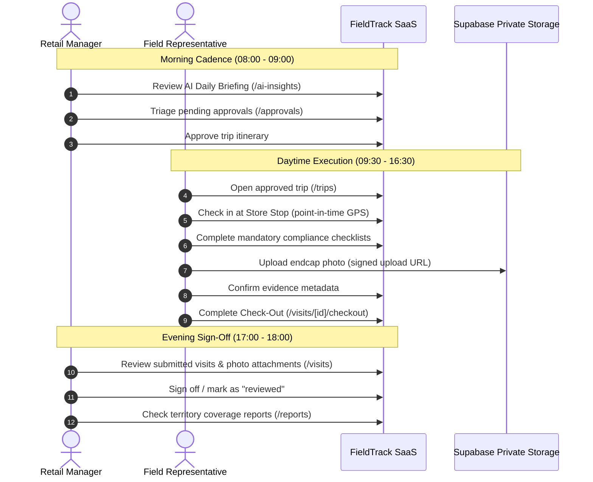

# FieldTrack — Controlled Retail Pilot Test Plan

## 1. Pilot Scope & Cohort Definition

| Parameter | Specification | Details |
| :--- | :--- | :--- |
| **Organization Target** | 1 Retail Business Tenant | Dedicated isolated workspace (e.g. "Apex Retail Group") |
| **Management Cohort** | 1 Retail Territory Manager | Responsible for scheduling, route review, approvals, and visit quality sign-off |
| **Field Representative Cohort** | 2 to 3 Field Representatives | Executing on-site audits, completing checklists, and uploading evidence |
| **Store Scope** | 10 to 15 Physical Retail Stores | Verified street addresses, cities, postal codes, and GPS coordinates |
| **Timeline** | **Day 0:** 1-Day Device Pre-Flight / Dry Run **Days 1–14:** Active Field Operations Pilot | Two consecutive 5-day workweeks |

---

## 2. Pilot Objectives & Key Success Metrics

| Goal | Success Indicator | Target Benchmark |
| :--- | :--- | :--- |
| **Operational Reliability** | Successful end-to-end trip execution (submission &rarr; approval &rarr; check-in &rarr; checkout) | &ge; 98% completion rate with 0 blocking exceptions |
| **Data Integrity & Evidence** | Checklists completed and photo evidence captured | 100% of required checklist items answered; &ge; 1 evidence photo per visit |
| **Offline Resilience** | Seamless audit execution in basements/dead zones without data loss | 100% of offline queued actions synced successfully upon reconnect |
| **User Experience & Friction** | Field rep check-in to check-out duration | < 12 minutes per store audit |
| **Security & Privacy** | Tenant isolation and location telemetry guardrails | 0 cross-tenant data leaks; 0 continuous background tracking events |

---

## 3. Phase A: Day 0 — Device Pre-Flight & Operational Dry Run

Before any field representative steps into a real store, the pilot coordinator conducts a 30-minute structured dry run on the exact hardware and mobile browsers used during the pilot.

### 3.1 Device Matrix
- **Device 1 (Android):** Android 12+ running Google Chrome v120+.
- **Device 2 (iOS):** iOS 16.4+ running Apple Safari (Home Screen PWA mode).

### 3.2 Dry Run Step-by-Step Script

| Step | Action | Expected Result | Pass/Fail |
| :--- | :--- | :--- | :--- |
| **D0.1** | Open invitation email on mobile device and tap activation link | Navigates to `/api/invitations/accept`, prompts for password, logs in user | [ ] |
| **D0.2** | Install as PWA (Chrome: "Install app" / Safari: "Add to Home Screen") | FieldTrack icon appears on home screen, launches in standalone full-screen window | [ ] |
| **D0.3** | Open `/trips` and view assigned test trip | Trip details, planned stops, and sequence numbers display clearly | [ ] |
| **D0.4** | Tap **"Check In"** on Stop 1 | Browser requests Location permission; coordinates recorded as `captured_unverified`; visit state becomes `in_progress` | [ ] |
| **D0.5** | Toggle **Airplane Mode ON** (Simulate zero cellular signal) | "Offline" banner appears in top navigation | [ ] |
| **D0.6** | Complete 3 checklist items and enter field notes while offline | Changes persist instantly in local storage (IndexedDB) without error modals | [ ] |
| **D0.7** | Toggle **Airplane Mode OFF** (Reconnect) | Offline banner clears; status indicates "Synced"; data reflects on server | [ ] |
| **D0.8** | Tap **"Upload Photo"** under Visit Evidence | Camera opens directly; photo uploads; server verifies storage and confirms record | [ ] |
| **D0.9** | Tap **"Complete Check Out"** | Visit state transitions to `submitted`; stop marks as `visited` | [ ] |
| **D0.10** | Manager opens `/visits` on desktop | Manager views submitted visit, reviews evidence photo, and marks visit as `reviewed` | [ ] |

---

## 4. Phase B: Days 1–14 — Active Controlled Pilot Schedule

### Daily Operational Cadence

### Week 1 Focus: Core Workflows & Offline Tolerance
- Days 1–2: Standard single-trip audits (2–3 stops per rep per day).
- Days 3–4: Route optimization test: Manager tests "AI Route Insights" to sequence stops.
- Day 5: Offline stress test: Reps execute audits in stores with known cellular dead spots.

### Week 2 Focus: Exceptions, Reporting & Manager Governance
- Days 6–8: Exception handling: Incomplete checklists triggering checkout validation blocks; store re-visits.
- Days 9–10: Territory coverage and export: Manager exports CSV reports for regional analysis.
- Days 11–14: Final evaluation, feedback compilation, and sign-off.

---

## 5. Privacy, Safety & Location Safeguards

1. **No Background Tracking:**
   - FieldTrack explicitly **never** runs continuous background GPS location polling.
   - GPS telemetry is only collected at the distinct moments of **Check-In** and **Check-Out**.
2. **Unverified Telemetry Disclosure:**
   - All captured coordinates are transparently labeled as `captured_unverified` (device-reported). They are intended to assist routing, not act as punitive employee surveillance.
3. **Automated Location Purge:**
   - Administrator can execute location data retention cleanups via `/api/orgs/[orgId]/location/purge` to permanently drop coordinates older than the retention policy (e.g. 30 days).
4. **Private Evidence Storage:**
   - Store photos are stored in the private bucket `visit-evidence` with strict `<org_id>/<visit_id>/<uuid>.<ext>` paths.
   - Photos are accessed strictly through short-lived signed URLs (120-second TTL); no public URLs exist.

---

## 6. Feedback Loop & Incident Triage Protocol

### Pilot Feedback Collection Channels
1. **End-of-Day Quick Survey (Rep):** 2-minute daily WhatsApp/Slack check-in:
   - "Did any screen freeze or fail to save today?"
   - "Did the camera or check-in require more than one tap?"
2. **Weekly Manager Review:** 20-minute structured review:
   - Reviewing daily briefing utility and approval workflow clarity.

### Severity & Response Matrix

| Severity | Definition | Examples | Response Target |
| :--- | :--- | :--- | :--- |
| **P1 - Critical** | Blocking pilot progress; data loss; security breach | Cannot log in; check-out consistently failing; cross-tenant data leak | Immediate response (< 1 hour); rollback or kill-switch |
| **P2 - Major** | Impaired functionality with a workaround | Offline queue fails to auto-sync but syncs on manual button; camera slow | Same-day remediation (< 8 hours) |
| **P3 - Minor** | Visual glitch or non-blocking UI improvement | Text alignment issue on small mobile screens; confusing tooltip | Queued for next deployment |

---

## 7. Pilot Exit Criteria

The pilot is considered successful and ready for production expansion when:
1. &ge; 95% of planned store visits were successfully completed and reviewed.
2. 0 instances of cross-tenant data leakage or authorization bypass occurred.
3. 0 unrecoverable data losses occurred during offline operation.
4. The retail manager successfully conducted daily approvals and weekly CSV report exports without developer intervention.
