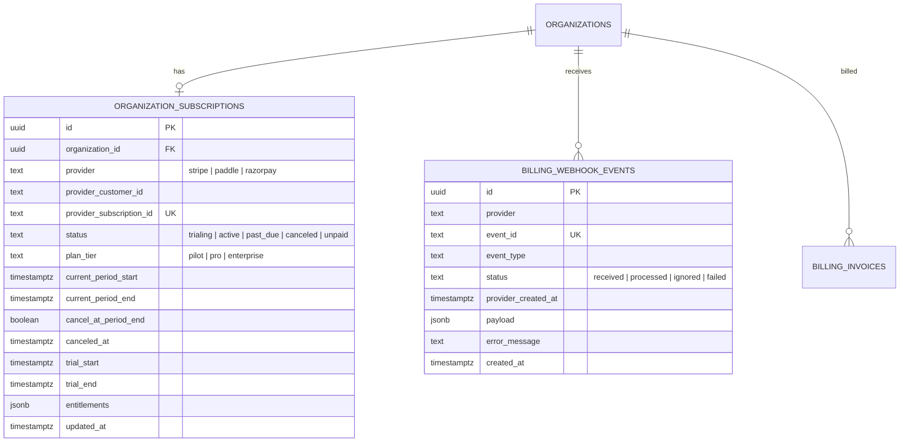
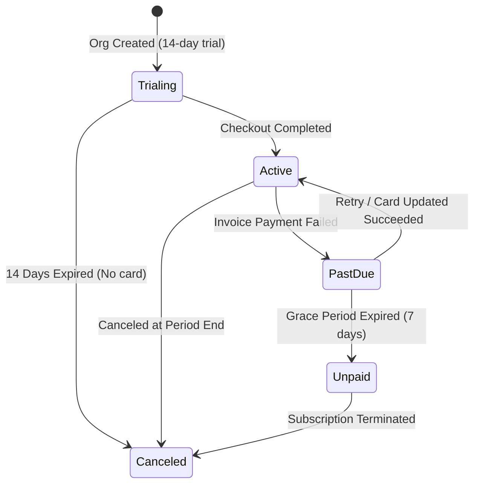
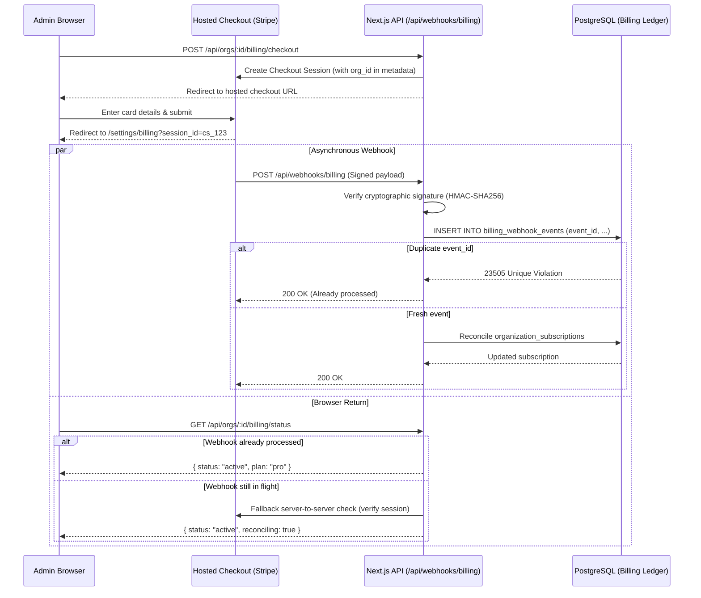

# FieldTrack Billing & Subscription Architecture Specification

**Status:** Pre-Implementation Architectural Specification  
**Governing Rule:** No billing code, test cards, or provider SDKs will be integrated into the core MVP until pricing tiers, plan limits, tax/receipt rules, and the payment provider are formally approved by the team.

---

## 1. Executive Summary & Core Principles

FieldTrack is a multi-tenant B2B SaaS platform. Adding monetization must preserve the stability, tenant isolation, and security guarantees established in earlier phases.

### Core Principles
1. **Never Trust the Client:** The client never reports whether a payment succeeded, nor does it assign its own plan or entitlements. Plan state is derived exclusively from trusted server-side provider webhooks and provider API reconciliation.
2. **Server-Only Secrets:** Payment provider secret API keys and webhook signing secrets reside strictly in server-only environment variables (`STRIPE_SECRET_KEY`, `STRIPE_WEBHOOK_SECRET`). They are never bundled into client components or logged.
3. **Idempotency & Replay Protection:** Every incoming provider webhook event ID is persisted with a unique constraint in a dedicated `billing_webhook_events` table. Duplicate or replayed deliveries are acknowledged immediately with `200 OK` without re-processing.
4. **Out-of-Order Resilience:** Webhooks may arrive out of order (e.g., `customer.subscription.updated` arriving before `customer.subscription.created`). Updates compare provider event timestamps (`created`) and subscription sequence numbers to ensure older events never overwrite newer database state.
5. **Fail-Safe Webhook Delays:** When a user completes checkout on a hosted portal, browser redirects indicate *intent to subscribe*, but entitlements are granted only after cryptographic signature verification of the committed webhook event or direct server-to-server verification.
6. **Zero Fakes in Production:** No mock payment bypasses or hard-coded test cards in production. Production billing requires explicit owner authorization.

---

## 2. Proposed Plans & Entitlements Matrix

| Feature / Limit | Free Pilot / Evaluation | Pro / Growth Tier | Enterprise Tier |
|---|---|---|---|
| **Target Audience** | Early pilots, 1-team trials | Regional FMCG distributors & retail brands | Large national/multinational retail enterprises |
| **Active Stores** | Up to 15 stores | Up to 150 stores | Custom / Unlimited |
| **Team Members** | Up to 5 members (1 Admin, 1 Manager, 3 Field) | Up to 30 members | Unlimited seats |
| **Monthly Visits** | Up to 50 completed visits / month | Up to 1,000 completed visits / month | Custom / Unlimited |
| **AI Visit Report Drafts** | 5 drafts / org / day (subject to server key) | 50 drafts / org / day | Custom daily quota |
| **Photo Evidence Storage** | 2 GB per organization | 50 GB per organization | Custom TB scale |
| **Audit Log Retention** | 30 days | 365 days | Unlimited (compliance archive) |
| **Hosted Portal Access** | Self-serve upgrade | Self-serve portal (payment method, invoices) | Invoiced (ACH / Wire / Net-30) |

---

## 3. Database Schema Design (Proposed Migration)



### Table Definitions

```sql
-- 1. Subscriptions tracking per tenant
create table public.organization_subscriptions (
  id uuid primary key default gen_random_uuid(),
  organization_id uuid not null references public.organizations(id) on delete cascade,
  provider text not null default 'stripe',
  provider_customer_id text not null,
  provider_subscription_id text null,
  status text not null default 'trialing',
  plan_tier text not null default 'pilot',
  current_period_start timestamptz null,
  current_period_end timestamptz null,
  cancel_at_period_end boolean not null default false,
  canceled_at timestamptz null,
  trial_start timestamptz not null default now(),
  trial_end timestamptz null,
  entitlements jsonb not null default '{
    "max_stores": 15,
    "max_members": 5,
    "max_monthly_visits": 50,
    "ai_daily_draft_quota": 5,
    "storage_limit_bytes": 2147483648
  }'::jsonb,
  created_at timestamptz not null default now(),
  updated_at timestamptz not null default now(),
  constraint organization_subscriptions_org_key unique (organization_id),
  constraint organization_subscriptions_sub_key unique (provider_subscription_id),
  constraint organization_subscriptions_status_chk check (
    status in ('trialing', 'active', 'past_due', 'canceled', 'unpaid', 'incomplete')
  ),
  constraint organization_subscriptions_plan_tier_chk check (
    plan_tier in ('pilot', 'pro', 'enterprise')
  )
);

-- RLS: Read-only for active organization admins; mutations by service-role webhook processor only.
alter table public.organization_subscriptions enable row level security;
alter table public.organization_subscriptions force row level security;

create policy org_subscriptions_select_admin_only
  on public.organization_subscriptions
  for select
  to authenticated
  using (
    public.has_active_org_role(organization_id, array['admin']::public.org_role[])
  );

-- 2. Append-only webhook ledger for replay prevention & auditing
create table public.billing_webhook_events (
  id uuid primary key default gen_random_uuid(),
  provider text not null,
  event_id text not null,
  event_type text not null,
  status text not null default 'received',
  provider_created_at timestamptz not null,
  payload jsonb not null,
  error_message text null,
  created_at timestamptz not null default now(),
  constraint billing_webhook_events_provider_event_key unique (provider, event_id),
  constraint billing_webhook_events_status_chk check (
    status in ('received', 'processed', 'ignored', 'failed')
  )
);

alter table public.billing_webhook_events enable row level security;
alter table public.billing_webhook_events force row level security;
-- No client policies: completely invisible to authenticated users.
```

---

## 4. Entitlement Enforcement Rules

Every state-changing action enforces plan limits server-side prior to database mutations:

1. **Store Creation (`POST /api/orgs/:id/stores`):**
   ```sql
   select count(*) from public.stores where organization_id = p_org_id and active = true;
   ```
   If active store count >= `entitlements.max_stores`, reject with `402 Payment Required` / `PLAN_LIMIT_EXCEEDED`:
   *"Store limit reached for your plan (15/15). Upgrade to Pro to add more stores."*
2. **Team Member Invitations (`POST /api/orgs/:id/invitations`):**
   Count active members + pending invitations. If >= `entitlements.max_members`, reject with `PLAN_LIMIT_EXCEEDED`.
3. **AI Draft Generation (`POST /api/orgs/:id/visits/:id/ai-report`):**
   Already integrated into Phase 8 via `ai_daily_draft_quota`. The billing engine directly updates this column in `public.organizations` based on the active plan tier.
4. **Evidence Uploads (`POST /api/orgs/:id/visits/:id/evidence?action=request_ticket`):**
   Aggregates total `file_size` from `public.visit_evidence`. If total storage exceeds `entitlements.storage_limit_bytes`, ticket issuance is rejected.

---

## 5. Subscription Lifecycle, Trials & Dunning

### Lifecycle State Machine



### Detailed Lifecycle Rules

#### 1. Evaluation Trial
- New organizations receive a 14-day evaluation trial of the Pilot plan with no credit card required upfront.
- When `now() > trial_end` and no payment method is attached:
  - Status transitions to `canceled`.
  - **Graceful degradation:** The account transitions to **read-only**. Existing data (trips, visits, evidence, audit logs, reports) remains accessible and exportable via CSV. Creating new trips, stores, or check-ins is blocked with an upgrade prompt.

#### 2. Failed Payments & Grace Period (Dunning)
- When a payment fails (`invoice.payment_failed`):
  - Status transitions to `past_due`.
  - An email alert and in-app manager notification are generated.
  - **3-Day to 7-Day Grace Period:** Field workers can continue logging store visits during temporary credit card expiration or billing bank delays so store operations are not disrupted in the field.
  - An urgent banner appears for Organization Admins: *"Your payment method failed. Please update billing details by [Date] to prevent interruption."*
- If retries fail after the grace period (`customer.subscription.deleted` or `invoice.marked_uncollectible`):
  - Status transitions to `unpaid` / `canceled`.
  - Mutations are locked (read-only mode engaged).

#### 3. Cancellation & Proration
- When an admin cancels in the hosted customer portal:
  - `cancel_at_period_end = true`.
  - Access remains active until `current_period_end`.
  - No unexpected mid-cycle cutoffs.
- Upgrades (Pilot -> Pro):
  - Billed immediately with proration. New store limits and AI quotas take effect instantaneously upon receipt of the verified webhook.

---

## 6. Webhook Processing & Resilience Against Delays



### Webhook Invariants
1. **Raw Body Preserved:** The webhook route handler reads the raw byte stream (`request.text()`) before any JSON parsing. Modifying the raw body breaks HMAC-SHA256 signature verification.
2. **Signature Verification:** `stripe.webhooks.constructEvent(body, signatureHeader, process.env.STRIPE_WEBHOOK_SECRET)` must succeed. If invalid, reject immediately with `400 Bad Request` and log a security warning.
3. **Idempotent Ledger:**
   ```sql
   insert into public.billing_webhook_events (provider, event_id, event_type, provider_created_at, payload)
   values ('stripe', p_event_id, p_type, p_created, p_payload)
   on conflict (provider, event_id) do nothing;
   ```
   If zero rows were inserted, the event was already handled; return `200 OK` immediately.
4. **Timestamp Ordering:** Before updating `organization_subscriptions`, verify that `provider_created_at >= organization_subscriptions.updated_at` to prevent stale out-of-order events from reverting newer state.

---

## 7. Tax, Invoicing & Regional Provider Evaluation

| Consideration | Stripe (Stripe Billing + Tax) | Razorpay (Razorpay Subscriptions) | Paddle / Lemon Squeezy (Merchant of Record) |
|---|---|---|---|
| **Best Suited For** | Global B2B SaaS (US, EU, UK, APAC) | Domestic Indian businesses (INR cards, UPI Autopay, Netbanking) | Global SaaS wanting hands-off international sales tax/VAT compliance |
| **Tax / Compliance** | Automatic calculation via Stripe Tax; collects GSTIN / VAT; emits compliant invoices. | Native GST calculation for India; e-invoicing compliant; supports SAC codes. | Acts as Merchant of Record (MoR). Handles all international tax filing, remittance, and compliance. |
| **Hosted UI** | **Stripe Checkout** & **Customer Portal** (zero PCI compliance scope; hosted card entry, invoice history, payment method updates). | Hosted Checkout modal; customer portal requires custom development or Razorpay dashboard. | Hosted checkout & billing portal provided out of the box. |
| **Recommended Path** | **Recommended for International SaaS** (highest reliability, built-in portal). | **Recommended if target market is exclusively domestic Indian companies** requiring UPI autopay. | **Recommended if company lacks legal entities in multiple tax jurisdictions**. |

---

## 8. Questions & Decisions Required Before Implementation

Before writing any billing code or database migrations, the team must confirm:

1. **Payment Provider Selection:**
   - [ ] Stripe (Recommended for international B2B)
   - [ ] Razorpay (Recommended for domestic India INR/UPI focus)
   - [ ] Paddle / Lemon Squeezy (Merchant of Record)
2. **Pricing & Currency Structure:**
   - What are the exact price points and currencies (e.g. \$49/month or ₹3,999/month for Pro)?
   - Will annual billing offer a discount (e.g. 2 months free)?
3. **Entitlement Thresholds:**
   - Are the proposed plan limits acceptable (Pilot: 15 stores / 5 members; Pro: 150 stores / 30 members)?
4. **Tax Registration Details:**
   - Is the business registered for GST (India), VAT (EU/UK), or US Sales Tax?
   - Do invoices require business legal name, registered address, and GSTIN / VAT ID inputs on checkout?
5. **Trial Terms:**
   - Is a 14-day card-free trial approved, followed by read-only account lock?
