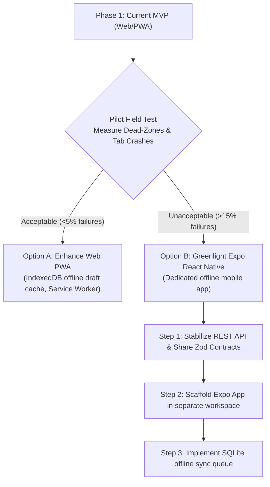
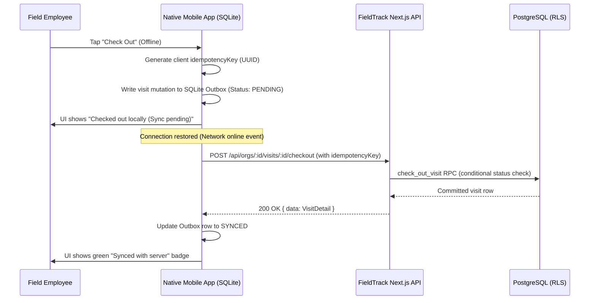

# Decision Memo: Responsive Web/PWA vs. Expo React Native for FieldTrack

**Date:** 2026-10-22  
**Document Status:** Ready for Review & Decision  
**Decision Target:** Architecture selection for mobile field execution (Option A vs. Option B)

---

## Executive Summary

FieldTrack's validated MVP provides a responsive, desktop- and mobile-friendly web application with strict tenant isolation, PostgreSQL RLS, offline-compatible database schemas (idempotency keys, optimistic locking, append-only audits), and unverified device location capture.

Field employees, however, operate in real-world retail and supermarket environments characterized by thick concrete walls, basement inventory rooms, intermittent cellular reception, and fragmented mobile hardware.

This memo evaluates whether to:
- **Option A: Retain and enhance the Responsive Web / Progressive Web App (PWA)**, or
- **Option B: Introduce a dedicated Expo React Native mobile client for iOS and Android**, operating as a separate workspace package consuming stabilized server contracts.

> [!IMPORTANT]
> **Primary Recommendation:** Proceed with **Option A (Responsive Web + PWA Service Worker caching)** for the immediate pilot phase, while standardizing client contracts. Transition to **Option B (Expo React Native)** only if pilot field metrics prove that iOS Safari background tab discards or PWA storage evictions disrupt daily store checkouts.

---

## Detailed Capability Comparison

| Capability / Dimension | Option A: Responsive Web / PWA | Option B: Expo React Native (iOS & Android) | Winner / Recommendation |
|---|---|---|---|
| **Offline Visit Execution** | Partial (Service Worker + CacheStorage + IndexedDB). Works while tab remains open, but vulnerable to OS eviction when switching to phone calls or camera. | **Full & Robust**. SQLite (`expo-sqlite`) or WatermelonDB with persistent local storage immune to OS browser tab eviction. | **Option B** |
| **Camera & Photo Capture** | `<input type="file" capture="environment">`. Triggers native camera, but on memory-constrained mobile devices (e.g. low-end Android, iPhone SE), returning from camera often reloads the browser tab, losing unsaved form state. | **Native Camera (`expo-camera` / `expo-image-picker`)**. Direct in-app viewfinder, embedded metadata stripping, local thumbnail compression before memory spikes. | **Option B** |
| **Evidence File Uploads** | Direct PUT to Supabase signed URLs via browser `fetch`. Fails if connection drops mid-upload; background uploads are killed when user locks phone or switches apps. | **Native Background Uploads (`expo-file-system` / native workers)**. Resumable chunked background uploads that persist even when the screen is locked or app is minimized. | **Option B** |
| **Push Notifications** | Web Push API is supported on modern Android Chrome and iOS 16.4+ (only if user manually taps "Add to Home Screen"). High user drop-off; unreliable delivery. | **Native Push (APNs & FCM via `expo-notifications`)**. Direct system push delivery for manager approvals, change requests, and reassignments with 99%+ reach. | **Option B** |
| **Device Permissions (Location & Camera)** | Ephemeral browser prompts. iOS Safari frequently prompts repeatedly or defaults to coarse location. User cannot easily re-enable if dismissed without navigating browser site settings. | **OS-Level Permissions (`expo-location`)**. Clean system permission dialogs; direct deep-linking to system Settings app if permission was denied. | **Option B** |
| **Background Behavior** | Severe restrictions. Safari on iOS aggressively suspends background workers within 30 seconds. No background upload queue. | Controlled background sync (`expo-background-fetch`, `expo-task-manager`) for queue retries when connection returns. | **Option B** |
| **Security & Credential Storage** | Cookies (HTTP-only) or Web Storage (localStorage/IndexedDB). Subject to XSS if frontend is compromised; 7-day Safari ITP eviction for non-visited PWAs. | **Hardware Keystore / Keychain (`expo-secure-store`)**. Secure enclave hardware encryption for auth tokens; biometric unlock (FaceID/Fingerprint). | **Option B** |
| **Development & Maintenance Effort** | **Low**. Single Next.js TypeScript codebase, shared React UI, instant zero-review deployments, zero app store fees ($0). | **High**. Second codebase, native dependencies, Apple Developer (\$99/yr) + Google Play (\$25) accounts, EAS build pipelines, store review delays. | **Option A** |
| **Release Velocity** | **Instant**. Code pushed to production runs immediately for all users; no legacy client version fragmentation. | **Delayed**. App Store / Play Store reviews take 24–72 hours; requires forced-upgrade API headers to retire legacy client versions. | **Option A** |
| **Time to Market** | **Immediate (Already deployed and functional)**. | **3–5 weeks** of engineering to build separate client, local sync queue, and app submission. | **Option A** |

---

## Technical Feasibility Analysis

### 1. Offline Store Visits
- **Web/PWA Reality:** Modern browsers provide CacheStorage for app shells and IndexedDB for JSON state. However, iOS Safari enforces a strict 7-day cap on script-writable storage if the user does not open the site frequently, and iOS aggressively purges Safari web processes when the user switches to another app (e.g., answering a call from a store manager). If an employee is halfway through a 20-item checklist and Safari is purged, unsaved in-memory state is lost unless continuously serialized to IndexedDB.
- **Expo React Native Reality:** The app process has dedicated OS application sandbox storage via SQLite (`expo-sqlite`). An employee can download the day's approved trip stops at 8:00 AM on Wi-Fi, enter a windowless store basement at 11:00 AM with zero cellular reception, check in, complete required checklist items, take photos saved to local cache files, check out, and continue. The app queues outgoing mutation envelopes locally.

### 2. Reliable Camera & Evidence Uploads
- **Web/PWA Reality:** Browser file inputs rely on device memory buffers. Taking five 12MP photos on an Android or iOS device in Safari can consume 150MB+ of uncompressed bitmap memory in the tab, frequently triggering OS OOM (Out Of Memory) tab reloads. Furthermore, if an upload ticket is requested, the browser must upload before the 120-second signed URL expires. If the network drops at 70%, standard browser fetch aborts.
- **Expo React Native Reality:** Photos are captured to file URIs on disk without loading full raw bitmaps into JS memory. Downscaled JPEG copies (e.g. max 1920px width, quality 0.8) are created locally on a native thread using `expo-image-manipulator`. Uploads can be resumed or queued sequentially.

### 3. Push Notifications & Alerting
- **Web/PWA Reality:** Web Push on iOS requires iOS 16.4+, PWA installation to Home Screen, and explicit user opt-in. Field employees rarely perform the 3-step "Share -> Add to Home Screen" dance without hands-on IT provisioning.
- **Expo React Native Reality:** Standard native push notifications via Apple Push Notification service (APNs) and Firebase Cloud Messaging (FCM). Managers approving trips or requesting changes trigger near-instant native push banners with badges and sounds.

### 4. Background Location Tracking (Explicit Policy)
> [!CAUTION]
> **No Background Location Tracking:** Regardless of whether Option A or Option B is selected, FieldTrack will **not** implement continuous background location tracking (geofencing or persistent GPS breadcrumbs). 
> - **Product Policy:** Location is captured *exclusively* as an unverified point-in-time timestamped event at the moment the employee taps "Check In" or "Check Out".
> - **Privacy & Battery:** Continuous background tracking drains battery during 8-hour field shifts, triggers severe iOS/Android OS background permission scrutinies, and raises intrusive employee surveillance liabilities.

---

## Maintenance & Operating Cost Tradeoffs

| Aspect | Option A: Responsive Web / PWA | Option B: Expo React Native |
|---|---|---|
| **Codebases** | 1 (Next.js TypeScript modular monolith) | 2 (Next.js server/web + Expo React Native client) |
| **Shared Code** | 100% shared domain models, schemas, and UI | Shared Zod schemas and TypeScript types only (`packages/types` or monorepo); UI rewritten in native primitives (`<View>`, `<Text>`) |
| **App Store Review Cycles** | 0 days (instant deploy) | 1–3 days per native binary update |
| **Version Fragmentation** | Zero. All users run current server release | High. Users on older app versions (v1.0.1, v1.1.0) hit production APIs simultaneously, requiring backward-compatible API versioning |
| **Developer Overhead** | 1 engineer handles full-stack features | Requires mobile build maintenance (EAS Build/Submit, CocoaPods, Android Gradle updates, SDK deprecations) |
| **Annual Platform Cost** | $0 | $99/year (Apple Developer) + $25 one-time (Google Play) + optional EAS cloud build tiers |

---

## Missing Evidence Required from Pilot

Before committing engineering resources to a separate native app, the following factual data points must be gathered from actual field pilots:

1. **Dead-Zone Frequency:** What percentage of target stores actually lack 3G/4G/5G connectivity at the entrance or audit aisles?
2. **Tab Discard Rate:** On the pilot team's actual company-issued or BYOD devices, does Safari/Chrome reload and drop form state during visit completion?
3. **Notification Latency Impact:** Does an employee need an immediate native push notification when a trip is approved, or is checking the in-app notification badge / SMS fallback sufficient?
4. **Device Fleet Demographics:** Are field workers using standardized enterprise devices (e.g. Samsung Galaxy A-series, iPhone 13) or diverse unmanaged personal devices with varying OS versions?

---

## Recommendation & Phased Roadmap

### Proposed Action:
1. **Do not create the React Native app today.**
2. Complete the controlled pilot rollout using the responsive mobile web interface already delivered and verified.
3. If pilot metrics demonstrate that camera memory pressure or offline connectivity breaks store checkouts, approve **Option B** and initiate native app development using the architecture blueprint below.

---

## Native Architecture Blueprint (If Option B is Approved)

If the user approves Option B, implementation will adhere strictly to the following architectural rules:

### 1. Workspace Isolation & Contract Reuse
- **Location:** A separate workspace directory `/apps/mobile` or `/packages/mobile`, keeping the Next.js server pristine.
- **Contract Reuse:** Directly import domain validation schemas from `@/modules/*` (Zod schemas, response envelope types `ApiEnvelope<T>`, parameter validators). **Never import browser DOM UI components.**

### 2. Supported SDKs & Version Alignment
- **Framework:** Expo SDK 52 (React Native 0.76+) with New Architecture enabled.
- **Storage:** `expo-secure-store` for Supabase JWT/refresh tokens; `expo-sqlite` with WAL mode for local offline visit data.
- **Camera & Photos:** `expo-image-picker` / `expo-camera` with downscaling to max 1920px prior to disk persistence.
- **Network & State:** TanStack React Query v5 with offline mutation queues and online status managers.

### 3. Explicit Offline Queue & Conflict Architecture

- **Idempotency:** Every offline check-in, checklist update, and check-out generates a client UUID `idempotencyKey` stored in SQLite and sent with HTTP payloads. Retries never produce duplicate visits or duplicate checklist answers.
- **Conflict Resolution (Server Authoritative):**
  - If a visit was already marked `submitted` or `reviewed` on the server by a manager, the client accepts the server state and marks the local queue item as superseded.
  - If a store or trip was archived while offline, the client surfaces a clean conflict explanation: *"Trip was modified or cancelled by management; your offline draft has been archived."*
- **Logout / Tenant Switch Data Clearing:**
  - When the employee signs out or switches organizations, `expo-secure-store` tokens are deleted, and all cached visit data/photos in SQLite and app document directories are wiped clean to prevent cross-tenant data leakage on shared devices.

### 4. Zero Secrets Principle
- The native app bundles **only** `EXPO_PUBLIC_SUPABASE_URL` and `EXPO_PUBLIC_SUPABASE_ANON_KEY`.
- **Zero service-role keys, zero OpenAI keys, zero database connection strings.** All AI draft requests and trip decisions route through authenticated server APIs under RLS.

### 5. App Store & Play Store Release Guardrails
- **Automated EAS Build:** Managed cloud credentials; separate internal-test and production release profiles.
- **Signing:** Apple distribution certificates and Android keystores managed in Expo Application Services (EAS) with hardware 2FA.
- **Zero Auto-Publish:** Builds generate signed binary artifacts (`.ipa`, `.aab`) that require explicit human approval and release notes before promotion to production tracks.
